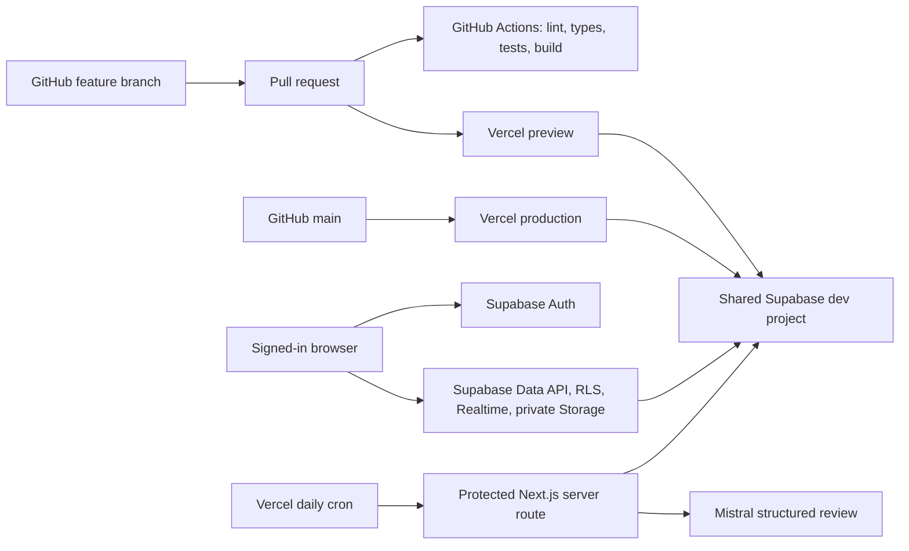

# Repository and service connections

Verified against the local checkout, GitHub PR checks, and the live fictional Supabase project.



## GitHub

- Repository: `beline-y/closer`; default branch: `main`.
- This branch incorporates `main` through `3f62bcd`, including PRs #10–#13: demo sign-in,
  shared personas, role shells and daily check-ins with photos/reactions/live family feed.
- `.github/workflows/ci.yml` checks pull requests and pushes to `main`: clean dependency
  installation, lint, type generation/checking, offline tests and production build.
- Work stays on a feature branch. Never push directly to `main`; use the repository's PR/review flow.
- `.env` is ignored. Local credentials must never be staged, committed, or copied into a PR body.

## Supabase

- Shared project: `zuzojjefoeewnylqjkzv`, confirmed by GitHub's Supabase integration check and
  live API authentication. Local `NEXT_PUBLIC_SUPABASE_URL` points to this project.
- `src/lib/supabase/client.ts`: browser client using the public key and signed-in session.
- `src/lib/supabase/server.ts`: request-scoped cookie client for server reads/actions; RLS applies.
- `src/proxy.ts`: refreshes cookies and routes signed-in users to their role. Its JWT role comes
  from server-managed app metadata. It is retained from `main`, including the existing demo flow.
- `src/lib/supabase/admin.ts`: server-only service client for the scheduled wellbeing job. Its key
  bypasses RLS; the job's SQL functions independently validate consent and current patient links.
- Auth, patient records, links, check-ins, photos and reactions already exist in the shared database.
  The wellbeing tables were installed by `20261024221143_daily_wellbeing.sql`.
- Check-ins use the canonical `activities[]` and `activity_note` columns. `sharedCheckin()` converts
  these to grounded model context. The wellbeing migration creates no duplicate check-in table
  and changes none of the photo/reaction access policies.
- Private check-in photos are in Supabase Storage and use signed URLs. Care staff and volunteers
  do not receive access. The model never reads photos or Storage objects.
- The public key, service key and demo passwords are enough for runtime access. They do **not**
  provide PostgreSQL DDL/migration access. CLI migration work separately requires a Supabase login
  with access to this project, or an authorized PostgreSQL connection.
- The CLI is now signed into the authorized account and linked to the correct project.
  Five migrations already applied by the team were recovered verbatim from the database's
  migration history: nudges, settings Realtime, menus/reactions, meal-column compatibility and
  activities. Their files are retained locally so future pushes preserve the real history.
  These schema changes are ahead of `main`; their feature UIs have not been merged here.
- The wellbeing migration was retimestamped after those applied migrations. After the user
  confirmed team coordination, its dry-run passed and the CLI applied only
  `20261024221143_daily_wellbeing.sql`. Canonical types were regenerated from the linked project.
  Daily processing remains opt-in; installation does not enable consent for any patient.
- The live reaction schema now allows one reaction per user/check-in and four emoji. The
  existing action and optimistic UI were adapted to replace an emoji rather than insert a
  conflicting second row; tapping the current emoji still removes it.

## Vercel

- Project: [`beline/closer`](https://vercel.com/beline/closer), verified from the GitHub Vercel bot.
- PR #13's existing preview: [mood-check-in preview](https://closer-git-feature-mood-checkin-beline.vercel.app).
  This preview is from `main`'s earlier feature work; it does not contain the unpushed wellbeing changes.
- GitHub integration builds feature PR previews and production from `main`.
- Previews and production currently use the same fictional Supabase dev database. Supabase's
  PR branching check is skipped, so a Vercel preview does not create an isolated Supabase database.
- `vercel.json` configures the production-only daily job at 12:00 UTC. Preview cron runs are manual.
- The locally authenticated Vercel user currently has only a personal team with no projects;
  this is different from the `beline` team. No new Vercel deployment or environment change was made.
- `.env` configures the local app only. Before an approved deployment, configure the server variables
  in the correct Vercel project's Preview/Production environment and redeploy. Never expose secret
  keys with a `NEXT_PUBLIC_` prefix.

## Feature data boundaries

| Feature | Data source |
| --- | --- |
| People, linked patients, demo sessions | Live Supabase Auth + RLS |
| Mood, meals, activities, notes | Live `mood_checkins` |
| Check-in photo and reactions | Live private Storage + protected tables |
| Family feed and role routing | Live queries and Realtime |
| Daily reviews, consent, personalized inbox | New migration + Mistral + protected daily route |
| Cards, questions, memories, volunteer workflows, some care metrics/threshold alerts | Existing typed demo fixtures until their feature migrations are built |

## Verification commands

```sh
npm run check
npm test
npm run build
npm run check:integrations  # live auth/RLS/schema checks; never writes application data
npm run test:wellbeing:live  # explicitly calls Mistral with synthetic fictional examples
```

`npm test` runs offline against the actual migration sequence in an in-memory Postgres engine.
`npm run db:test` runs the repository's pgTAP integration suite against a linked shared project,
inside rollback transactions; it needs the correct CLI database access. It is separate from the
offline test suite and from the live Mistral smoke test.

The integration checker exits with code 2 for missing wellbeing migration tables, and code 1 for
an actual connection, authentication or access-boundary failure. Test sign-outs are scoped to their
own local session; the app's demo role switch is scoped the same way.

## Verified on 2026-10-24

- Lint, canonical types, 27 offline tests and the production build pass.
- All 71 cloud pgTAP assertions pass inside rollback transactions, including consent,
  atomic delivery, duplicate prevention, evidence privacy and guardian-link revocation.
- The live integration checker reports zero failures and zero missing tables for all four roles.
- Three synthetic live Mistral examples pass (activity, sustained low mood and priority concern).
- The local scheduler returns 401 for absent/wrong credentials and 200 for valid credentials:
  zero failed jobs and three skipped patients because daily processing has not been opted into.
  This checks live scheduler/database connectivity; it does not claim a real-patient model review ran.
- Vercel production activation still requires the server variables in the `beline/closer` project
  and a deployment containing this code. The current local Vercel account cannot administer that team.
