# Closer AI: results on simulated children

Generated by `python -m closer_ai evaluate`: 300 validation and 500 test children, never seen in training. Workload budget: **0.4 alert units per child-week** (a digest alert counts 1, a priority alert 1.5). Everything here is simulated: it shows that the method works and where it breaks, not clinical performance.

## 1. Belief: the wellbeing assessor

| | Additive model (deployed) | Gradient boosting (black box) |
|---|---|---|
| AUC distress vs rest | 0.920 | 0.923 |
| AUC fragile or distress | 0.855 | 0.855 |
| Calibration error (ECE, distress) | 0.014 | |

AUC for distress by age: 5-7 0.918, 8-11 0.928, 12-17 0.915. The interpretable model matches the black box, so the explanation shown to the psychologist is the model's actual reasoning.

## 2. Shield: deterministic safety rules on simulated notes

14,520 notes, 49 with crisis language, 84 with strong statements.

| | Rate |
|---|---|
| Crisis notes raising an urgent alert | 73% |
| Crisis notes raising an alert of any level | 73% |
| Strong statements raising a priority alert | 96% |
| Ordinary notes wrongly flagged as a crisis | 0.00% |

The misses are indirect phrasings planted on purpose ("j'ai écrit un mot pour dire au revoir à tout le monde"). Claude's second reading (`--claude`) is there for them.

## 3. Decision: the RL agent against the alternatives, at the same workload

Test cohort. *Unsupported distress days*: days a child spends in distress before a psychologist sees them (no visit since 2 days before the episode started). Lower is better.

| Policy | Unsupported distress days / child-week | Workload / child-week | Episodes reached | Median delay (days) | Alert precision | Questions / child-week | Worst 10% of children |
|---|---|---|---|---|---|---|---|
| No AI alert (shield only) | 0.797 | 0.00 | 11% | 2.0 | n/a | 0.00 | 3.47 |
| Spec rules (3 low moods, 2 days without check-in or family) | 0.226 | 0.83 | 42% | 1.0 | 26% | 0.00 | 1.39 |
| Threshold on P(distress), tau=0.30 | 0.290 | 0.39 | 46% | 1.0 | 67% | 0.00 | 1.48 |
| Threshold + gentle questions, tau=0.30 | 0.238 | 0.43 | 48% | 1.0 | 78% | 0.56 | 1.23 |
| RL agent without questions, lambda=0.50 | 0.251 | 0.43 | 49% | 1.0 | 60% | 0.00 | 1.35 |
| **RL agent, lambda=0.40** | 0.241 | 0.40 | 44% | 1.0 | 70% | 0.38 | 1.25 |
| Oracle (sees the hidden state, not a real option) | 0.095 | 0.47 | 58% | 1.0 | 100% | 0.00 | 0.54 |

Paired differences on the same children, with 95% bootstrap intervals (unsupported distress days per child-week; negative means the RL agent does better):

- RL agent vs threshold: -0.049 [-0.078, -0.019], -17% of the threshold's harm
- RL agent vs threshold + questions: +0.003 [-0.022, +0.029], +1% of the threshold's harm
- RL agent vs RL agent without questions: -0.010 [-0.028, +0.007], -3% of the threshold's harm

## 4. Trade-off curves (validation cohort)

Each method traces workload against harm as its knob moves: the threshold tau, or for the RL agent the price of an alert lambda (one network, every point).



Unsupported distress days per child-week at equal workload, read off each curve (linear interpolation between measured points; best in bold):

| Workload / child-week | Threshold | Threshold + questions | RL agent without questions | RL agent |
|---|---|---|---|---|
| 0.15 | 0.427 | 0.447 | 0.399 | **0.371** |
| 0.20 | 0.371 | 0.382 | 0.338 | **0.311** |
| 0.30 | 0.281 | 0.279 | 0.258 | **0.249** |
| 0.40 | 0.250 | 0.223 | 0.214 | **0.208** |
| 0.50 | 0.215 | **0.171** | 0.181 | 0.176 |

All measured points:

| Method | Knob | Workload / child-week | Unsupported distress days / child-week |
|---|---|---|---|
| Threshold | tau=0.15 | 0.57 | 0.197 |
| Threshold | tau=0.20 | 0.49 | 0.218 |
| Threshold | tau=0.25 | 0.42 | 0.245 |
| Threshold | tau=0.30 | 0.35 | 0.261 |
| Threshold | tau=0.35 | 0.31 | 0.276 |
| Threshold | tau=0.40 | 0.27 | 0.300 |
| Threshold | tau=0.45 | 0.23 | 0.321 |
| Threshold | tau=0.50 | 0.21 | 0.360 |
| Threshold | tau=0.60 | 0.16 | 0.414 |
| Threshold | tau=0.70 | 0.12 | 0.473 |
| Threshold | tau=0.80 | 0.09 | 0.533 |
| Threshold + questions | tau=0.15 | 0.56 | 0.155 |
| Threshold + questions | tau=0.20 | 0.53 | 0.155 |
| Threshold + questions | tau=0.25 | 0.46 | 0.191 |
| Threshold + questions | tau=0.30 | 0.40 | 0.223 |
| Threshold + questions | tau=0.35 | 0.35 | 0.238 |
| Threshold + questions | tau=0.40 | 0.32 | 0.269 |
| Threshold + questions | tau=0.45 | 0.28 | 0.295 |
| Threshold + questions | tau=0.50 | 0.26 | 0.318 |
| Threshold + questions | tau=0.60 | 0.23 | 0.343 |
| Threshold + questions | tau=0.70 | 0.18 | 0.408 |
| Threshold + questions | tau=0.80 | 0.15 | 0.447 |
| RL agent | lambda=0.05 | 2.01 | 0.019 |
| RL agent | lambda=0.09 | 1.39 | 0.040 |
| RL agent | lambda=0.16 | 0.95 | 0.097 |
| RL agent | lambda=0.28 | 0.53 | 0.166 |
| RL agent | lambda=0.50 | 0.33 | 0.230 |
| RL agent | lambda=0.89 | 0.19 | 0.316 |
| RL agent | lambda=1.58 | 0.11 | 0.428 |
| RL agent | lambda=2.81 | 0.02 | 0.639 |
| RL agent | lambda=5.00 | 0.00 | 0.742 |
| RL agent without questions | lambda=0.05 | 2.09 | 0.023 |
| RL agent without questions | lambda=0.09 | 1.45 | 0.041 |
| RL agent without questions | lambda=0.16 | 1.08 | 0.072 |
| RL agent without questions | lambda=0.28 | 0.64 | 0.135 |
| RL agent without questions | lambda=0.50 | 0.40 | 0.215 |
| RL agent without questions | lambda=0.89 | 0.25 | 0.281 |
| RL agent without questions | lambda=1.58 | 0.14 | 0.406 |
| RL agent without questions | lambda=2.81 | 0.06 | 0.551 |
| RL agent without questions | lambda=5.00 | 0.00 | 0.738 |
| Spec rules | | 0.85 | 0.189 |

## 5. Robustness: simulators nobody tuned on

| Shift | Policy | Unsupported distress days / child-week | Workload / child-week |
|---|---|---|---|
| More children masking distress (35%) | Threshold | 0.317 | 0.38 |
| More children masking distress (35%) | RL agent | 0.246 | 0.39 |
| Fewer notes (40% of the usual rate) | Threshold | 0.303 | 0.40 |
| Fewer notes (40% of the usual rate) | RL agent | 0.249 | 0.40 |
| More stress (x1.3) | Threshold | 0.403 | 0.50 |
| More stress (x1.3) | RL agent | 0.335 | 0.46 |
| More children without family (25%) | Threshold | 0.324 | 0.53 |
| More children without family (25%) | RL agent | 0.276 | 0.50 |

## 6. What the agent learned

### The price of an alert changes the behavior



| Price lambda | Action as P(distress) rises (typical 12-year-old, day 10, nothing recent) |
|---|---|
| 0.05 | priority |
| 0.19 | digest |
| 0.41 (deployed) | ask, digest from 0.22 |
| 1.08 | wait, ask from 0.30, digest from 0.66 |
| 2.32 | wait, ask from 0.58 |

### The rules it follows: VIPER distillation into a decision tree

20 leaves, extracted by Q-weighted DAgger. On states the tree itself visits, it takes the network's action 91% of the time, and 57% of the time when the network raises an alert.

| Policy | Unsupported distress days / child-week | Workload / child-week |
|---|---|---|
| RL agent (network) | 0.241 | 0.40 |
| Distilled tree | 0.279 | 0.34 |

```text
if p_distress_change <= 0.11:
    if p_stable <= 0.70:
        if days_since_alert <= 13.5 days:
            -> wait
        else:  # days_since_alert > 13.5 days
            if p_stable <= 0.43:
                -> digest
            else:  # p_stable > 0.43
                if age <= 7.5 years:
                    -> wait
                else:  # age > 7.5 years
                    if p_distress <= 0.02:
                        -> wait
                    else:  # p_distress > 0.02
                        -> ask
    else:  # p_stable > 0.70
        -> wait
else:  # p_distress_change > 0.11
    if days_since_alert <= 5.5 days:
        -> wait
    else:  # days_since_alert > 5.5 days
        if p_stable <= 0.49:
            -> digest
        else:  # p_stable > 0.49
            -> ask
```

## 7. A whole ward and one psychologist: the neural Whittle index

20 beds kept full; the psychologist can answer *k* alerts a day, and each evening the policy decides who she sees.

| Who gets the visits | k per day | Unsupported distress days / child-week |
|---|---|---|
| Nobody (shield only) | 1 | 0.750 |
| Spec rules | 1 | 0.359 |
| Highest P(distress) | 1 | 0.298 |
| **Highest Whittle index (RL)** | 1 | 0.238 |
| Oracle | 1 | 0.128 |
| Nobody (shield only) | 2 | 0.750 |
| Spec rules | 2 | 0.219 |
| Highest P(distress) | 2 | 0.158 |
| **Highest Whittle index (RL)** | 2 | 0.122 |
| Oracle | 2 | 0.071 |

Indexability check: the agent alerts less as the price rises in 100% of the sampled states, which is what makes the index meaningful.

_Run time: 3 min._
