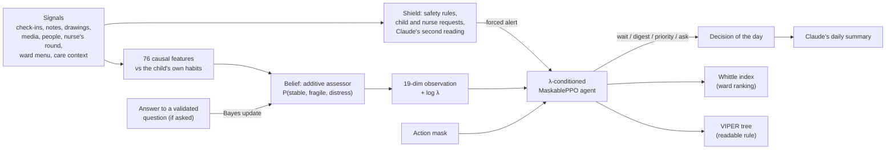

# The RL architecture of Closer AI

How the alerting agent is built, trained, deployed and evaluated. For what the module does and how to run it, see
[README.md](README.md); for the numbers, see [RESULTS.md](RESULTS.md). Everything here runs on fictional, simulated
children.

## 1. The problem in one paragraph

Every evening, for every hospitalized child, the system decides whether the psychologist should see them. Alerting
too late leaves a child alone with their distress; alerting too often wears out a psychologist whose time is a hard
budget. Decisions change the future (a visit helps, and changes what we observe next), the child's real state is
hidden behind noisy signals, and the system can buy information by asking the child a short validated question.
That is a **constrained, partially observable, sequential decision problem**, which is exactly what RL is for. The
estimate of how the child is doing is not RL: it is a supervised model, used as the agent's belief.

## 2. The pipeline

The same code builds the observation, the mask and the shield in training (`policy/env.py`) and in production
(`pipeline.py`): the agent sees exactly the same quantities on a simulated child and on a real one.

## 3. Formal model: a constrained POMDP

| Element | Definition |
|---|---|
| Hidden state $z_t$ | stable, fragile or distress, one per child and day |
| Dynamics | Markov transitions driven by stressors (big days, isolation, days without family, pain, length of stay, roommate leaving) and support (family visits, the psychologist's visits). See section 6 |
| Observations | Noisy, partly missing signals: the child's check-ins and notes, app usage, drawings, media, visits, the nurse's round. Some children hide distress behind good moods |
| Belief $b_t$ | $P(z_t \mid \text{history})$ from the assessor, sharpened by Bayes' rule when the child answers a question |
| Actions $a_t$ | `wait`, `digest` (non-urgent alert in the psychologist's daily list), `priority` (seen today), `ask` (a short validated question tomorrow, 8 years and up) |
| Horizon | One episode is one stay: 14 to 42 days, one decision per evening, $\gamma = 0.95$ |

### Reward and constraint

The harm the agent minimizes:

$$
h_t = \underbrace{\mathbb 1[z_t = \text{distress} \wedge \text{no visit since the episode started} - 2\text{ days}]}_{\text{an unsupported distress day}}
\;+\; 0.1 \cdot \mathbb 1[z_t = \text{fragile} \wedge \text{no visit in 7 days}]
$$

subject to the psychologist's workload $c_t$ (1 unit per digest, 1.5 per priority) staying under a weekly budget
$B$, here 0.4 units per child-week. Asking a question costs the child a small burden $0.05$.

The constrained problem $\min_\pi \mathbb E[\sum_t \gamma^t h_t]$ s.t. $\mathbb E[\text{workload}] \le B$ is solved
through **Lagrangian relaxation**:

$$
r_t = -\,h_t \;-\; \lambda\, c_t \;-\; 0.05 \cdot \mathbb 1[a_t = \text{ask}]
$$

$\lambda$ is the shadow price of one unit of the psychologist's time, measured in "days of unsupported distress".
Instead of a dual-ascent loop on $\lambda$, the agent is **conditioned on it** (section 5), and $\lambda$ is set at
deployment to meet the budget.

## 4. What the agent sees

### Belief: the assessor (supervised, not RL)

A generalized additive model: each of the 76 features goes through its own cubic B-spline (5 knots), with
missing-value indicators, then a multinomial logistic regression ($C = 0.3$). Being additive, the log-odds of
distress split exactly into one contribution per feature, which is what the care tab shows as "what weighs most
today". Its AUC for distress matches gradient boosting, so interpretability costs nothing. Inference is plain numpy,
about 130 µs per child-day, fast enough to run inside the RL environment at every step.

Features are causal (day $t$ only uses data up to $t$) and mostly relative to the child's own baseline. Missing data
stays missing: not checking in is itself a signal, and app usage the store never received is unknown, never zero.
Every drawing becomes an 18-value vector (colors from the pixels, what Claude sees drawn), and 5 features compare
this week's drawings with the child's own earlier ones, shrunk toward a population prior early in the stay. The
nurse's round adds 11 features (how the child looked, engagement during care, pain score, sleep, refused care,
the nurse's request, meals eaten, and meals eaten **relative to the other children on the same dish**).

### Information gathering: the "ask" action

When the agent asks, the child answers a short validated scale the next day. Its normalized score $s$ updates the
belief by Bayes' rule, with a Gaussian likelihood per state ($\mu = 0.15, 0.45, 0.75$; $\sigma = 0.12$) and a weight
that fades over 3 days:

$$
b'(z) \;\propto\; b(z)\cdot \mathcal N(s;\,\mu_z,\,\sigma)^{\,1 - \text{age}/3}
$$

Whether a question is worth its burden depends on how uncertain the belief is: the agent learns that value of
information instead of following a hand-set rule.

### The observation vector (19 values, all in [-1, 1])

| Group | Components |
|---|---|
| Belief | `p_stable`, `p_fragile`, `p_distress`, `p_distress_change` (vs yesterday), `p_distress_max_3d` |
| Data freshness | `checkins_3d`, `days_since_checkin` |
| Alert history | `days_since_alert`, `days_since_psy_contact`, `alerts_7d` (the agent's own) |
| Questions | `screening_recent`, `screening_score`, `days_since_ask` |
| Context | `age`, `day_of_stay`, `has_family` |
| Shield | `forced_alert_today` (a rule already alerted), `concern_3d` (strong statements in notes) |
| Price | `log_lambda`, the price of one workload unit, rescaled to [0, 1] |

### The action mask (part of the shield)

| Action | Allowed when |
|---|---|
| `digest` | no alert of any kind in the last 2 days (no spam) |
| `priority` | no priority or urgent alert in the last 2 days |
| `ask` | the child is 8 or older, and no question in the last 3 days |

A masked action becomes `wait`. The mask is applied in training (MaskablePPO never samples a masked action) and in
production.

### The shield, outside the agent

Deterministic rules run before the agent, and nothing the agent does can remove their alert:

| Trigger | Alert |
|---|---|
| Crisis language in a note, a shared drawing's title or the nurse's note (rules, or Claude's second reading), or a drawing Claude sees explicitly showing self-harm or an adult hurting the child | urgent |
| Strong statements (worthless, unloved, fear of dying) | priority |
| The child taps "I'd like to talk to someone" | priority |
| The nurse ticks "I'd like the psychologist to see this child" | priority |

In training the shield is part of the environment: its alerts schedule visits in the simulator and appear in the
observation, so the agent learns not to duplicate them. The agent can make the system more attentive, never less
(shielded RL, Alshiekh et al. 2018).

## 5. Training: λ-conditioned MaskablePPO

**Multi-objective by conditioning.** At every episode $\lambda$ is drawn log-uniformly in $[0.05, 5]$ and appended
to the observation. One network therefore learns the whole family of policies, from "alert at the slightest doubt"
to "almost never": the Pareto front between harm and workload comes out of a single training run, and the deployed
operating point is a dial, not a retraining.

| Setting | Value |
|---|---|
| Algorithm | MaskablePPO (sb3-contrib), separate policy and value MLPs, 128 × 128 |
| Parallel environments | 14 simulated stays (subprocesses), 256 steps each per rollout |
| Batch, epochs | 896, 8 epochs per rollout |
| Discount, GAE | $\gamma = 0.95$, $\lambda_{GAE} = 0.95$ |
| Learning rate | $3\cdot10^{-4}$, decayed linearly to 10% |
| Entropy, clipping | 0.02, 0.2 |
| Budget | 5M steps, about 25 to 30 min on 16 CPU cores |

**Domain randomization.** Each training episode draws its own simulator: share of children who mask distress,
children without family, isolation, crisis-note rate, stress scale, note frequency, how much a visit helps, how much
masking fools the nurse, how often app usage is missing. The policy is trained on a distribution of worlds rather
than on one guess. Training seeds never overlap the validation and test cohorts.

**One lesson from training.** The first agent never asked questions: the answer only reached the belief through a
feature it hardly used, so asking looked useless and entropy collapsed before it could learn otherwise. Folding the
answer into the belief by Bayes' rule (section 4) and a higher entropy bonus fixed it. Information-gathering actions
only pay off if the observation model makes their value visible.

## 6. The environment: a simulator of fictional stays

`simulator.py` and `policy/env.py` (Gymnasium). Per day:

1. **Context**: big days (procedures, known 3 days ahead), isolation, visit restrictions, roommate leaving, room
   change, planned discharge; pain and treatment fatigue (fatigue lowers mood and activity *without* distress: a
   confounder on purpose).
2. **Hidden state**: a stress score from the context, days without family and length of stay, scaled by the child's
   vulnerability, minus support. Transitions stable ↔ fragile ↔ distress follow logistic functions of stress and
   support. A psychologist's visit adds support that fades over 5 days.
3. **Observations**: check-in with probability depending on the state, mood with a personal bias and noise (raised
   for masking children), optional extras, notes in French or English generated from topics, app usage (hidden for
   some children), drawings, media, visits, the nurse's round (brief, often skipped, less fooled by masking), the ward
   menu with the leave-one-out intake of ten other children.
4. **Effect of the decision**: an urgent alert brings a visit the next day; a priority alert, the next day 95% of the
   time; a digest, the next day 60% of the time, otherwise often the day after. A question brings an answer the next
   day.

**Common random numbers.** Every random draw comes from a stream keyed by (child, day, purpose). Two policies that
leave a child in the same state see exactly the same future, which makes paired comparisons tight. Simulations do
not depend on hash order (tested under two `PYTHONHASHSEED` values).

## 7. Deployment

- **Choosing λ.** The evaluation sweeps λ on a validation cohort and keeps the price that meets the budget (0.4 units
  per child-week). It is stored in `artifacts/policy.json` and read by the evening job.
- **Every evening** (`python -m closer_ai run`), and again for one child whenever the care tab sends new input
  (`python -m closer_ai serve`): load the window, compute features and belief, run the shield, build the
  observation and mask, take the agent's action, compute the Whittle index and the tree's rule, have Claude write the
  summary, store the assessment and the alerts.
- **Within a day, decisions only escalate.** An alert or a question already sent stands; a later run can raise a
  digest to priority, never cancel it. Today's own alerts are left out of the observation, so a re-run sees what the
  agent saw in training: the day before it acts.
- **Fallback.** Without a trained agent, a threshold on P(distress) with a 3-day cooldown takes over.

## 8. A whole ward: the neural Whittle index

A ward is a **restless multi-armed bandit**: every child keeps evolving whether visited or not, and the psychologist
sees at most $k$ children a day. Whittle's relaxation prices each visit at λ and splits the ward into independent
one-child problems, which is exactly the problem the λ-conditioned agent solves. A child's index is the highest price
at which the agent still asks for a visit:

$$
W(\text{child}) = \max\{\lambda \in \text{grid} : \pi(o, \lambda) \in \{\text{digest}, \text{priority}\}\}
$$

read off the network on 25 log-spaced prices in one batched forward pass. Visiting the $k$ highest indices is the
classic asymptotically optimal heuristic (Whittle 1988; Weber & Weiss 1990). It is only meaningful if the problem
is **indexable**, meaning the agent alerts less as the price rises; `whittle.indexability` measures it on sampled
states instead of assuming it.

## 9. Explaining the policy: VIPER

Bastani, Pu & Solar-Lezama (2018). The network is distilled into a decision tree of at most 20 leaves by DAgger, with
each visited state weighted by how much the choice matters there:

$$
w(s) = \max_a Q(s,a) - \min_a Q(s,a)
$$

$Q$ is estimated by rolling the teacher out from clones of the environment for a few days, then bootstrapping with
the PPO critic; common random numbers make the rollouts of different actions comparable. Four DAgger rounds; the
best student is kept. The tree prints as nested if/else rules in plain units ("days since alert > 5.5"), and the
evening job stores the path that decided today's action with each alert. Fidelity is reported overall and on the states where the
network alerts, because those are the ones that matter.

## 10. How we evaluate

- **Separate cohorts**: training seeds, a validation cohort (to set λ and τ), a test cohort for the final table.
- **Baselines**: no AI alert, the spec's hand rules, a tuned threshold on P(distress), the threshold plus a
  hand-made "ask when unsure" rule, the agent without the ask action (an ablation trained for the same number of
  steps), and an oracle that sees the hidden state (an upper bound, not an option).
- **Same workload**: methods are compared at equal psychologist workload, on full trade-off curves.
- **Paired bootstrap**: the same children for every policy (common random numbers), 2,000 resamples, 95% intervals.
- **Risk**: the worst 10% of children (CVaR), not only the average.
- **Robustness**: shifted simulators nobody tuned on (more masking, fewer notes, more stress, more children without
  family).
- **The ward**: 20 beds over 90 days, $k = 1$ or $2$ visits a day, Whittle index against the alternatives.

Headline results are in [RESULTS.md](RESULTS.md): at the same workload, about 17% fewer unsupported distress days
than a tuned threshold; on a ward, 20 to 23% fewer than visiting the highest P(distress) first. Those numbers were
measured before the nurse's round was added; `python -m closer_ai evaluate` regenerates them.

## 11. Limits

- **The simulator is the model of the world.** Every result holds in the world we wrote. A psychologist should
  review its assumptions (transition strengths, how much a visit helps, how masking works), and the reward weights
  and budget are choices to make with them.
- **No exploration on real children, ever.** Moving to real data means off-policy evaluation from logged decisions,
  and the labels are selective (only alerted children get reviewed), which routine screenings would correct.
- **The shield's rules are a starting point**, reviewed with the psychologist; Claude's second reading covers
  indirect phrasings they miss.

## 12. Volunteer matching: a contextual bandit

A second, smaller decision problem (`matching.py`): which volunteer to suggest to each child this week. It is a
**combinatorial contextual bandit**: each week the care team suggests pairs, and the nurse's rating of a visit,
$r \in \{0, 0.5, 1\}$ (hard, okay, went well), is the reward.

- **Context.** For a child $c$ and a volunteer $v$, $x_{cv}$ = (1, affinity, shared interests, age fit, how their
  earlier visits went), then a one-hot of $v$. The affinity is Claude's reading of the child's age and interests next
  to the volunteer's public story: strong 1, good 0.66, some 0.33, none 0.
- **Model.** Bayesian linear regression $r = \theta^\top x + \varepsilon$, $\varepsilon \sim \mathcal N(0, 0.3^2)$.
  The prior says what we believe before any visit: affinity matters most, and each volunteer's own effect is centered
  on zero ($\sigma = 0.15$). Conjugate updates, refit on every request:

$$
\Sigma = \left(\Sigma_0^{-1} + X^\top X / \sigma^2\right)^{-1}, \qquad \mu = \Sigma\left(\Sigma_0^{-1}\mu_0 + X^\top r / \sigma^2\right)
$$

- **Exploration.** Pairs are scored by an upper confidence bound (LinUCB, Li et al. 2010),
  $s_{cv} = \mu^\top x_{cv} + \kappa \sqrt{x_{cv}^\top \Sigma\, x_{cv}}$ with $\kappa = 0.5$. Unlike Thompson sampling it
  is deterministic, so the board does not reshuffle on reload, and a volunteer with few rated visits keeps the benefit
  of the doubt.
- **Assignment.** Need weights $w_c$: 1, plus 1 with no family linked, plus $1 - P(\text{stable})$ from the assessor,
  plus 0.3 with no recent volunteer visit, minus 0.5 with a request in progress. Maximize $\sum w_c\, s_{cv}$ with at
  most one suggestion per child and each volunteer's free visits as capacity: the Hungarian algorithm on a matrix with
  one column per free visit, plus a "no suggestion" column per child worth $0.5\, w_c$, so a weak match is not forced.
- **Safety.** It only suggests. The child asks, the care team and the guardian approve, volunteers see nothing.

In simulation (`matching.simulate`: 10 children, 8 volunteers offering 2 visits a week, a hidden volunteer effect
drawn from $\mathcal N(0, 0.2^2)$), learning lifts the chance that a visit goes well over weeks 9 to 16 from 69%
(affinity alone) to 75%, on 10 seeds out of 10.

## 13. Code map

| File | Role |
|---|---|
| `simulator.py`, `notes_gen.py` | The world: hidden states, context, observations, the nurse, the menu |
| `features.py`, `assessor.py` | Causal features; the additive belief model and its explanations |
| `safety.py` | The shield's rules |
| `policy/obs.py` | Observation, action mask, Bayes update, alert bookkeeping (shared by training and production) |
| `policy/env.py` | The Gymnasium environment: reward, shield in the loop, cloning for rollouts |
| `policy/train.py` | λ-conditioned MaskablePPO |
| `policy/baselines.py` | Spec rules, thresholds, ask heuristic, oracle, the trained agent's wrapper |
| `policy/whittle.py` | Whittle indices, indexability, the ward simulation |
| `policy/distill.py` | VIPER |
| `evaluate.py`, `report.py` | Cohorts, metrics, paired bootstrap, CVaR, the report |
| `pipeline.py` | The evening job: the same pieces on real data |
| `matching.py` | The volunteer matching: affinity, Bayesian LinUCB, need weights, the Hungarian assignment |
